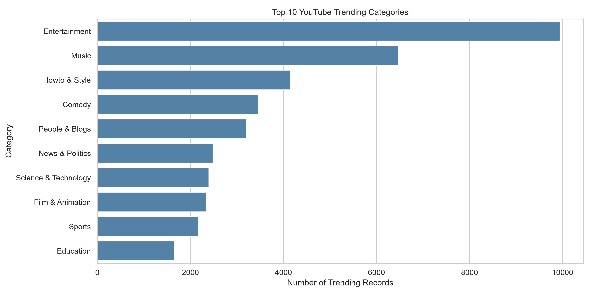
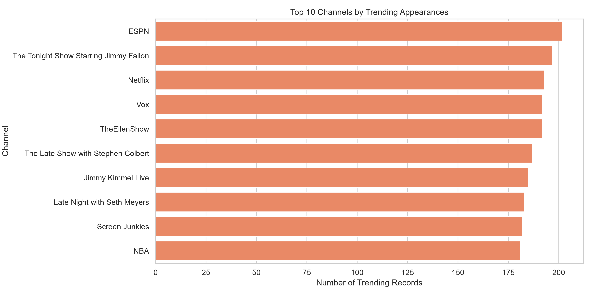
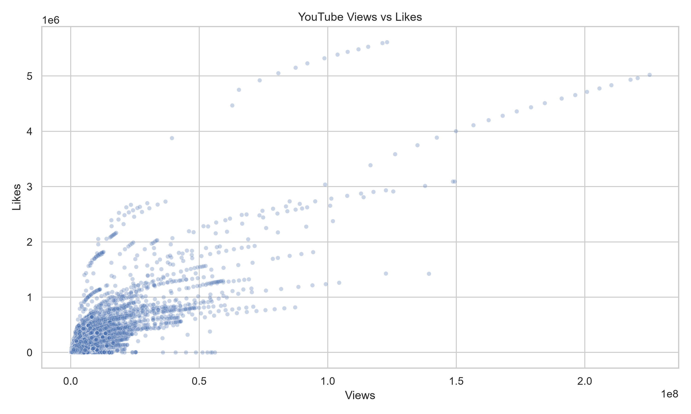
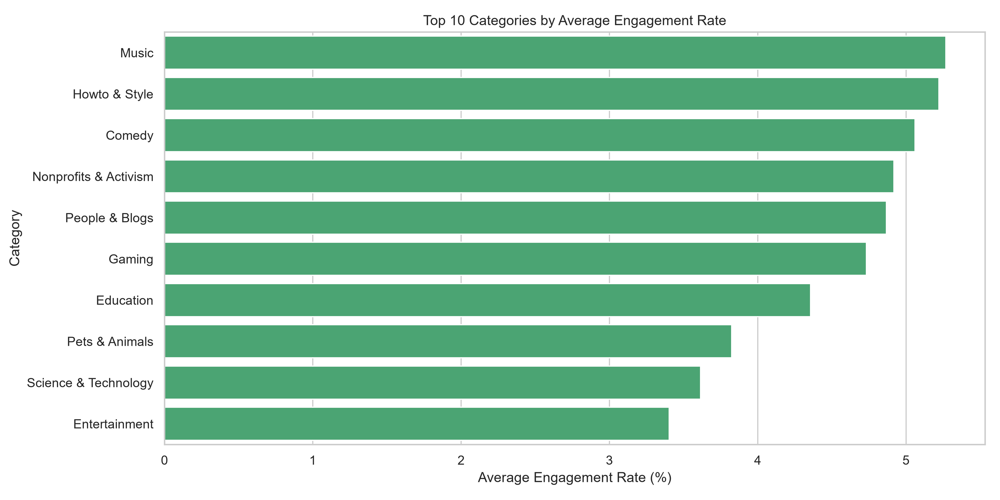
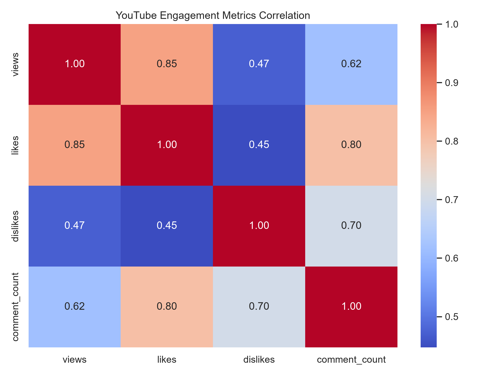

# YouTube Trending Videos Analysis

## Project Overview

This project performs Exploratory Data Analysis (EDA) on historical YouTube trending videos in the United States using Python.

The goal is to explore trending video categories, popular channels, audience engagement, and relationships between views, likes, dislikes, and comments.

## Technologies Used

- Python
- Pandas
- NumPy
- Matplotlib
- Seaborn

## Dataset

**Dataset:** Trending YouTube Video Statistics

**Source:** [Kaggle — datasnaek/youtube-new](https://www.kaggle.com/datasets/datasnaek/youtube-new)

Files used:
- `USvideos.csv`
- `US_category_id.json`

The dataset contains historical YouTube trending video records from 2017–2018.

## Project Workflow

1. Loaded the CSV dataset using Pandas.
2. Checked missing values and duplicate records.
3. Removed 48 exact duplicate rows.
4. Mapped category IDs to category names using JSON.
5. Analyzed video views, likes, comments, categories, and channels.
6. Calculated a descriptive engagement rate.
7. Created and saved five visualizations.
8. Exported an analysis summary.

## Analysis Results

| Metric | Result |
|---|---|
| Original records | 40,949 |
| Records after cleaning | 40,901 |
| Exact duplicates removed | 48 |
| Unique videos | 6,351 |
| Unique channels | 2,207 |
| Average views | 2,360,678.04 |
| Average likes | 74,271.73 |
| Average comments | 8,448.57 |
| Average engagement rate | 4.05% |

## Key Findings

- Entertainment had the most trending appearances, with 9,944 records.
- Music ranked second, with 6,467 trending appearances.
- ESPN was the most frequently appearing channel, with 202 records.
- Views and likes had a strong positive correlation of approximately 0.85.
- Likes and comment counts had a positive correlation of approximately 0.80.

Trending appearances are counted by dataset row. A video appearing on multiple trending dates may contribute multiple records.

## Visualizations

### Top Trending Categories


### Top Trending Channels


### Views vs Likes


### Category Engagement


### Correlation Heatmap


## How to Run

1. Download the dataset from Kaggle.
2. Place `USvideos.csv` and `US_category_id.json` inside the `data/` folder.
3. Install the dependencies:

```bash
python -m pip install -r requirements.txt
```

4. Run the Python program:

```bash
python youtube_analysis.py
```

The generated charts and summary will be saved in the `outputs/` folder.

## Limitations

- The dataset represents historical US YouTube trends, not live trending videos.
- The same video may appear on multiple trending dates.
- Engagement rate is a custom descriptive calculation, not an official YouTube metric.
- Correlation does not establish causation.

## Project Status

**Completed — Project 3 of 9 in the AI/ML Mini Projects portfolio.**