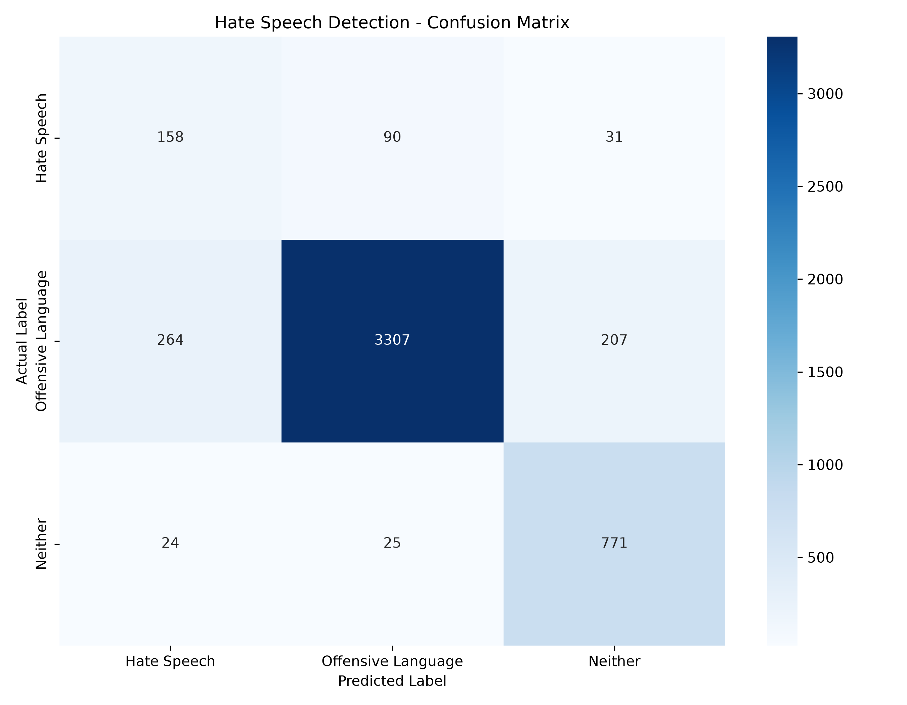

# Hate Speech Detection Using NLP

## Project Overview

This project uses Natural Language Processing (NLP) and machine learning to classify text into three categories:

- Hate Speech
- Offensive Language
- Neither

The classifier uses TF-IDF text features and Logistic Regression. It is a learning project and is not intended for automated content moderation.

## Technologies Used

- Python
- Pandas
- Scikit-learn
- Matplotlib
- Seaborn
- Joblib

## Dataset

**Name:** Hate Speech and Offensive Language Dataset

**Source:** [Davidson et al. GitHub Repository](https://github.com/t-davidson/hate-speech-and-offensive-language)

**Dataset file:** `labeled_data.csv`

The original dataset contains 24,783 labeled tweets.

The three class labels are:

| Label | Category |
|---|---|
| 0 | Hate Speech |
| 1 | Offensive Language |
| 2 | Neither |

The dataset contains potentially offensive and harmful text. Its annotations may contain subjective judgments and biases.

## Project Workflow

1. Load the dataset using Pandas.
2. Check for missing values.
3. Clean text by removing URLs, mentions, and unwanted characters.
4. Remove duplicate cleaned text records.
5. Convert text into TF-IDF features using unigrams and bigrams.
6. Split data into training and testing sets.
7. Train a Logistic Regression classifier with balanced class weights.
8. Evaluate accuracy, precision, recall, and F1-score.
9. Generate a confusion matrix.
10. Save the trained model and test it interactively.

## Model Evaluation

| Metric | Result |
|---|---:|
| Original records | 24,783 |
| Cleaned records | 24,383 |
| Training records | 19,506 |
| Testing records | 4,877 |
| Accuracy | 86.86% |
| Macro F1-score | 0.73 |
| Weighted F1-score | 0.88 |

### Classification Report

| Category | Precision | Recall | F1-score |
|---|---:|---:|---:|
| Hate Speech | 0.35 | 0.57 | 0.44 |
| Offensive Language | 0.97 | 0.88 | 0.92 |
| Neither | 0.76 | 0.94 | 0.84 |

## Confusion Matrix



## Sample Predictions

| Input Text | Predicted Category |
|---|---|
| I had a wonderful day today! | Neither |
| This movie is absolutely terrible. | Neither |
| You are so annoying and rude. | Offensive Language |

These predictions are examples, not guarantees of model behavior.

## How to Run

1. Download `labeled_data.csv` from the dataset repository.
2. Place the file in the `data/` folder.
3. Install dependencies:

```bash
python -m pip install -r requirements.txt
```

4. Run the program:

```bash
python hate_speech_detector.py
```

5. Enter text to classify, or type `exit` to stop.

## Limitations

- Hate Speech precision is only 35%, indicating a high false-positive rate.
- Hate Speech recall is 57%, so the model misses some hateful content.
- The dataset is imbalanced, with significantly fewer Hate Speech examples.
- The model may perform poorly on unfamiliar language, slang, and context-dependent expressions.
- Predictions should not be used as definitive moderation decisions.
- The dataset and its annotations may reflect sampling and labeling biases.

## Future Improvements

- Experiment with improved text preprocessing.
- Compare Logistic Regression with other classifiers.
- Explore deep learning models.
- Evaluate performance on additional datasets.
- Improve minority-class performance and calibration.

## Project Status

Completed — Project 4 of 9 in the AI/ML Mini Projects portfolio.